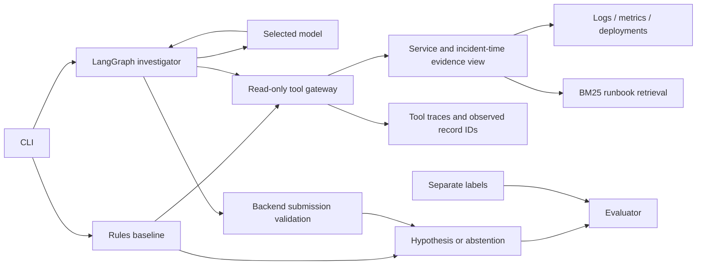

# Incident Lab

**A tool-using incident investigator with an inspectable baseline, bounded execution, and reproducible failure analysis.**

Incident Lab investigates synthetic service incidents using logs, metrics, deployment history, and versioned runbooks. It compares fixed diagnostic rules with a LangGraph agent and records the evidence behind each result.

The engineering question: **does a model improve diagnostic coverage without guessing when evidence is missing?** The first local Qwen3-8B run found a cause the rules missed, but handled abstention less reliably.

## Results you can inspect

| Eight-case development suite | Rules | Qwen3-8B, local Ollama |
| --- | --- | --- |
| Expected behavior matches, including abstentions | 7/8 | 5/8 |
| Correct diagnoses on diagnosable cases | 3/4 | 4/4 |
| Correct abstentions when required | 4/4 | 1/4 |
| Execution failures | 0 | 1 |

This is one run per hand-authored synthetic case, not a held-out benchmark. Qwen guessed on insufficient and conflicting evidence and failed the submission protocol after a tool outage. [Read the failure analysis](docs/qwen3-8b-comparison.md) or [inspect the full recorded traces](examples/ollama-qwen3-8b/comparison.json).

**Status: v0.1.0 research prototype.** Real local Ollama inference is verified. Hosted Groq/Anthropic adapters are tested with mocked HTTP responses. There is no live production-service integration or remediation execution.

## Quickstart: no account, model, or dependencies

Requires **Python 3.11 or newer**. Python 3.11-3.14 are covered by the test configuration. Git is needed only for cloning.

```bash
git clone https://github.com/NourMedjedel/incident-lab.git
cd incident-lab
python3 -m incident_lab demo --scenario INC-001 --output artifacts/config-trace.json
```

If you downloaded a source archive, extract it and run commands from the folder containing `pyproject.toml`. On systems where Python is named `python` rather than `python3`, substitute that executable after checking its version.

Expected result, with timing and evidence details omitted:

```text
Engine: rules-v1 (no LLM calls)
Status: hypothesis
Suspected cause: invalid_configuration
```

The output cites the configuration-error log and preceding deployment, retrieves the visible runbook version, and lists tool calls. The JSON trace is written under `artifacts/`, which Git ignores.

```bash
python3 -m incident_lab list
python3 -m incident_lab demo --scenario INC-006
python3 -m incident_lab evaluate
```

`INC-006` demonstrates an unavailable telemetry tool. `evaluate` writes baseline results to `artifacts/evaluation.json` and `artifacts/evaluation.md`; the expected behavior score is **7/8**.

## Reproduce the saved model scores offline

This regrades the checked-in model predictions. It does not require Ollama, an API key, LangGraph, or a model download.

```bash
python3 -m incident_lab replay examples/ollama-qwen3-8b/comparison.json
```

Expect **7 baseline matches, 5 agent matches, and 1 recorded agent execution failure**. The command verifies fixture hashes and writes a new report under `artifacts/`. Its request counts and timings describe the historical inference run; the replay itself makes **zero model requests**. See [reproducibility](docs/reproducibility.md).

## Run a real local model

Install [uv](https://docs.astral.sh/uv/getting-started/installation/) and [Ollama](https://ollama.com/download), and start the Ollama app/server before running:

```bash
uv sync --locked --extra agent
ollama pull qwen3:8b
uv run --locked --extra agent incident-lab agent --provider ollama --model qwen3:8b --scenario INC-007
```

The model download is about 5.2 GB and needs additional working memory. No hosted model API key is required. The adapter uses the local server at `127.0.0.1:11434` and does not fall back to a hosted provider. New model outputs and timings may differ from the saved example.

To run all eight cases, with per-case progress:

```bash
uv run --locked --extra agent incident-lab compare --provider ollama --model qwen3:8b
```

The recorded comparison took about 159 seconds in total; this is an observation from one machine, not a hardware requirement or completion-time promise. Outputs are `artifacts/comparison.json` and `artifacts/comparison.md`. The command exits with status 1 if a case has an execution failure, while still saving the report.

For Groq's hosted free tier, Anthropic, credentials, request limits, and troubleshooting, see [provider setup](docs/free-prototype.md). Hosted accounts must be configured appropriately for their billing plan; this application cannot inspect or change it.

## How it works



- Evidence is restricted to the incident service and cutoff time; runbook retrieval selects the latest visible version before scoring.
- The agent chooses its read-only tools within model/tool-call budgets. It receives no filesystem or shell capability.
- The backend validates the final schema, fetched citation IDs, and required telemetry. A citation ID check establishes provenance, not semantic correctness.
- Missing telemetry, unsupported output, model errors, and abstention remain distinct outcomes in the trace and evaluation.

The baseline uses explicit signatures. Its runbook retrieval supplies reference material after the rules form a hypothesis. The model can retrieve runbooks during investigation. This is keyword retrieval, not a dense-vector or hybrid-search implementation.

## Develop and test

```bash
uv sync --locked --extra dev --extra agent
uv run --locked --extra dev ruff check .
uv run --locked --extra dev ruff format --check .
uv run --locked --extra dev --extra agent pytest
python3 scripts/check_docs.py
```

Without optional dependencies, the baseline and offline replay still run with the standard library. `python3 -m unittest discover -s tests -v` runs available tests and explicitly skips optional graph/SDK tests.

CI runs checks without API keys, Ollama, or paid inference. Package building and installation are checked separately. [Verification status](docs/verification.md) distinguishes locally completed checks from remote CI and Docker checks.

## Project guide

| Start here | Purpose |
| --- | --- |
| [Reproducibility](docs/reproducibility.md) | Setup, locked dependencies, offline replay, and model-result limits |
| [Provider setup](docs/free-prototype.md) | Ollama, hosted options, environment variables, and common errors |
| [Agent design](docs/agent.md) | Workflow, validation, budgets, and tracing |
| [Evaluation](docs/evaluation.md) | Metrics, case descriptions, and grading policy |
| [Data provenance](docs/data.md) | Synthetic fixture schema and label interpretation |
| [Architecture decisions](docs/adr/0001-baseline-before-agent.md) | Baseline-first rationale; see also [agent orchestration](docs/adr/0002-bounded-agent-and-explicit-results.md) |
| [Contributing](CONTRIBUTING.md) | Local checks and useful contributions |
| [Changelog](CHANGELOG.md) | Scope of the initial public version |

## Known limits and next work

The dataset has eight development cases and a four-label cause vocabulary. It does not measure general incident reasoning, production reliability, or prompt-injection resistance. Saved results expose unsupported diagnoses, weak runbook relevance, and protocol failure; they are not hidden by the overall score.

Next work: stronger evidence-sufficiency and abstention policies, recovery from invalid submissions, independently authored evaluation cases, then live-service adapters and supervised sandbox actions. Kubernetes, Bedrock, and production operations integration are future work.

## License

Project code and hand-authored synthetic fixtures are [MIT licensed](LICENSE). Models and third-party dependencies retain their own licenses; no model weights are distributed here.
