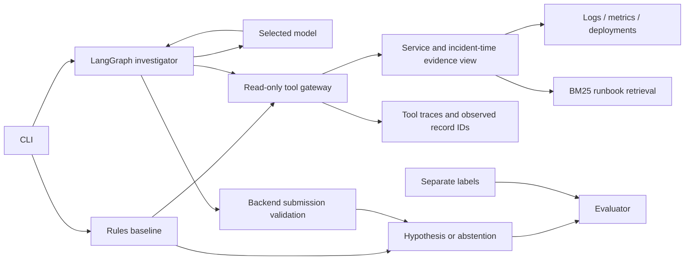

# Incident Lab

**A tool-using incident investigator with an inspectable baseline, bounded execution, and reproducible failure analysis.**

When a service fails, engineers must piece together logs, metrics, recent changes, and runbooks under time pressure. Incident Lab tests whether an AI investigator can gather that evidence, explain a likely cause, and hand the case to a human when the evidence is missing or conflicting. A local service demonstrates the full workflow: observe a failure, investigate it, obtain approval for a specific recovery action, and check that requests succeed again.

Incident Lab investigates synthetic service incidents using logs, metrics, deployment history, and versioned runbooks. It compares fixed diagnostic rules with a LangGraph agent and records the evidence behind each result.

The engineering question: **does a model improve diagnostic coverage without guessing when evidence is missing?** The first local Qwen3-8B run found a cause the rules missed, but handled abstention less reliably. Version 0.2 adds backend evidence contracts, bounded response recovery, and a real local HTTP service with supervised configuration recovery.

## Results you can inspect

| Original v0.1 run: eight development cases | Rules | Qwen3-8B, local Ollama |
| --- | --- | --- |
| Expected behavior matches, including abstentions | 7/8 | 5/8 |
| Correct diagnoses on diagnosable cases | 3/4 | 4/4 |
| Correct abstentions when required | 4/4 | 1/4 |
| Execution failures | 0 | 1 |

This is one run per hand-authored synthetic case, not a held-out benchmark. Qwen guessed on insufficient and conflicting evidence and failed the submission protocol after a tool outage. [Read the failure analysis](docs/qwen3-8b-comparison.md) or [inspect the full recorded traces](examples/ollama-qwen3-8b/comparison.json).

The guarded v0.2 workflow matched **8/8 original cases** and **11/12 additional challenge cases**, with zero accepted incorrect diagnoses and zero execution failures in this recorded run. The missed challenge case was an unnecessary abstention. These are project-authored cases; the result measures the combined model, controller, and evidence policy. [Inspect the current results and remaining failures](docs/reliability-results.md).

**Status: v0.2.0 local reliability lab.** Real local Ollama inference and an isolated HTTP service are supported. The original v0.1 results above remain preserved. Recovery is restricted to restoring the sandbox's fixed known-good configuration after explicit approval. Hosted Groq/Anthropic adapters remain mock-tested; Kubernetes, Bedrock, and external production operations are future work.

## Quickstart: no account, model, or dependencies

Requires **Python 3.11 or newer**. Python 3.11-3.14 are covered by the test configuration. Git is needed only for cloning.

```bash
git clone https://github.com/NourMedjedel/incident-lab.git
cd incident-lab
python3 -m incident_lab demo --scenario INC-001 --output artifacts/config-trace.json
```

If you downloaded a source archive, extract it and run commands from the folder containing `pyproject.toml`. On systems where Python is named `python` rather than `python3`, substitute that executable after checking its version.

Expected result, with timing and evidence details omitted:

```text
Engine: rules-v1 (no LLM calls)
Status: hypothesis
Suspected cause: invalid_configuration
```

The output cites the configuration-error log and preceding deployment, retrieves the visible runbook version, and lists tool calls. The JSON trace is written under `artifacts/`, which Git ignores.

```bash
python3 -m incident_lab list
python3 -m incident_lab demo --scenario INC-006
python3 -m incident_lab evaluate
```

`INC-006` demonstrates an unavailable telemetry tool. `evaluate` writes baseline results to `artifacts/evaluation.json` and `artifacts/evaluation.md`; the expected behavior score is **7/8**.

## Reproduce the saved model scores offline

This regrades the checked-in model predictions. It does not require Ollama, an API key, LangGraph, or a model download.

```bash
python3 -m incident_lab replay examples/ollama-qwen3-8b/comparison.json
```

Expect **7 baseline matches, 5 agent matches, and 1 recorded agent execution failure** for the original v0.1 run. The command verifies fixture hashes and writes a new report under `artifacts/`. Its request counts and timings describe the historical inference run; the replay itself makes **zero model requests**. See [reproducibility](docs/reproducibility.md).

Replay the current guarded results with distinct output paths:

```bash
python3 -m incident_lab replay examples/reliability-v2/development.json --output artifacts/replay-v2-development.json --report artifacts/replay-v2-development.md
python3 -m incident_lab replay examples/reliability-v2/challenge.json --output artifacts/replay-v2-challenge.json --report artifacts/replay-v2-challenge.md
```

Expect **8/8** and **11/12** agent behavior matches, respectively.

## Exercise a real HTTP failure and supervised recovery

This runs a SQLite-backed orders service on an ephemeral loopback port, makes actual HTTP requests, injects a configuration failure, and investigates it through HTTP tools. It uses the rules baseline by default and needs no model or account:

```bash
python3 -m incident_lab sandbox demo
python3 -m incident_lab sandbox demo --approve
```

The first command stops at a pending proposal. The second explicitly authorizes the demo action and verifies recovery with real requests: **HTTP 200 → HTTP 503 → HTTP 200**. State, role tokens, approvals, and audit history persist under the ignored `artifacts/` directory.

For a model-driven investigation of that same running service:

```bash
uv run --locked --extra agent incident-lab sandbox demo --provider ollama --model qwen3:8b --approve
```

The agent never receives write credentials or action tools. Approval expires, exact parameters are fingerprint-bound, state revisions must match, and repeated execution is idempotent. See the [manual operator workflow and trust boundary](docs/sandbox.md).

## Run a real local model

Install [uv](https://docs.astral.sh/uv/getting-started/installation/) and [Ollama](https://ollama.com/download), and start the Ollama app/server before running:

```bash
uv sync --locked --extra agent
ollama pull qwen3:8b
uv run --locked --extra agent incident-lab agent --provider ollama --model qwen3:8b --scenario INC-007
```

The model download is about 5.2 GB and needs additional working memory. No hosted model API key is required. The adapter uses the local server at `127.0.0.1:11434` and does not fall back to a hosted provider. New model outputs and timings may differ from the saved example.

To run all eight cases, with per-case progress:

```bash
uv run --locked --extra agent incident-lab compare --provider ollama --model qwen3:8b
```

The recorded comparison took about 159 seconds in total; this is an observation from one machine, not a hardware requirement or completion-time promise. Outputs are `artifacts/comparison.json` and `artifacts/comparison.md`. The command exits with status 1 if a case has an execution failure, while still saving the report.

For Groq's hosted free tier, Anthropic, credentials, request limits, and troubleshooting, see [provider setup](docs/free-prototype.md). Hosted accounts must be configured appropriately for their billing plan; this application cannot inspect or change it.

## How it works



- Evidence is restricted to the incident service and cutoff time; runbook retrieval selects the latest visible version before scoring.
- The agent chooses its read-only tools within model/tool-call budgets. It receives no filesystem or shell capability.
- The backend validates the final schema, fetched citation IDs, and required telemetry. A citation ID check establishes provenance, not semantic correctness.
- Missing telemetry, unsupported output, model errors, and abstention remain distinct outcomes in the trace and evaluation.
- Version 0.2 checks minimum diagnostic evidence and competing signals in the backend. After primary evidence requires escalation, the controller exposes only an abstention submission. These are application-policy decisions, not claims that the model independently learned safe behavior.
- Corrective responses are bounded and traced; an exhausted budget remains an execution failure.

The baseline uses explicit signatures. Its runbook retrieval supplies reference material after the rules form a hypothesis. The model can retrieve runbooks during investigation. This is keyword retrieval, not a dense-vector or hybrid-search implementation.

## Develop and test

```bash
uv sync --locked --extra dev --extra agent
uv run --locked --extra dev ruff check .
uv run --locked --extra dev ruff format --check .
uv run --locked --extra dev --extra agent pytest
python3 scripts/check_docs.py
```

Without optional dependencies, the baseline and offline replay still run with the standard library. `python3 -m unittest discover -s tests -v` runs available tests and explicitly skips optional graph/SDK tests.

CI runs checks without API keys, Ollama, or paid inference. Package building and installation are checked separately. [Verification status](docs/verification.md) distinguishes locally completed checks from remote CI and Docker checks.

## Project guide

| Start here | Purpose |
| --- | --- |
| [Reproducibility](docs/reproducibility.md) | Setup, locked dependencies, offline replay, and model-result limits |
| [Provider setup](docs/free-prototype.md) | Ollama, hosted options, environment variables, and common errors |
| [Agent design](docs/agent.md) | Workflow, validation, budgets, and tracing |
| [Current experiment](docs/reliability-results.md) | Guarded Qwen results, missed diagnosis, runtime manifest, and live recovery |
| [Reliability controls](docs/reliability.md) | Evidence sufficiency, admissible actions, response repair, and challenge cases |
| [Live sandbox](docs/sandbox.md) | Real HTTP failure injection, explicit approval, and verified recovery |
| [Evaluation](docs/evaluation.md) | Metrics, case descriptions, and grading policy |
| [Data provenance](docs/data.md) | Synthetic fixture schema and label interpretation |
| [Architecture decisions](docs/adr/0001-baseline-before-agent.md) | Baseline-first rationale; see also [agent orchestration](docs/adr/0002-bounded-agent-and-explicit-results.md) |
| [Contributing](CONTRIBUTING.md) | Local checks and useful contributions |
| [Changelog](CHANGELOG.md) | Scope of the initial public version |

## Known limits and next work

The original dataset has eight development cases; a separate project-authored challenge suite adds twelve edge cases. Neither is independently authored or held out. The four-label cause vocabulary and recognized telemetry contracts do not measure general incident reasoning, production reliability, or prompt-injection resistance. Original failures remain preserved.

Next work: independently reviewed evaluation cases, broader structured telemetry contracts, better retrieval, sustained-load and recovery testing, and external service adapters. The local sandbox currently exercises one recoverable configuration failure and demonstrates control boundaries on one machine. Kubernetes, Bedrock, and production identity/operations integration are future work.

## License

Project code and hand-authored synthetic fixtures are [MIT licensed](LICENSE). Models and third-party dependencies retain their own licenses; no model weights are distributed here.
