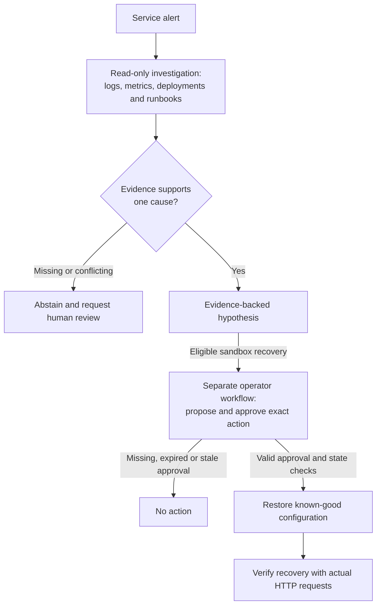

# Incident Lab

[](https://github.com/NourMedjedel/incident-lab/actions/workflows/ci.yml)

**An AI incident investigator that gathers evidence, abstains when it cannot justify a diagnosis, and keeps recovery under operator control.**

When a service fails, engineers must piece together logs, metrics, recent changes, and runbooks under time pressure. Incident Lab tests whether an AI investigator can gather that evidence, explain a likely cause, and hand the case to a human when evidence is missing or conflicting. A local service demonstrates the workflow: observe a failure, investigate it, approve a specific recovery action, and check that requests succeed again.

Built with **Python, LangGraph, Ollama/Qwen3, BM25 retrieval, HTTP, and SQLite**. No paid API is required for the local demo.

## Investigation and recovery flow



## Recorded results

| Expected behavior matches | Rules baseline | Guarded Qwen3-8B |
| --- | --- | --- |
| Original eight cases | 7/8 | 8/8 |
| Twelve additional challenge cases | 10/12 | 11/12 |

The guarded run accepted **zero incorrect diagnoses** and had **zero execution failures**. It missed one supported diagnosis by abstaining unnecessarily. These are single runs on project-authored synthetic cases, not independent benchmarks or production accuracy claims. The result measures the model **and** its backend policies.

[Results, traces, and remaining failures](docs/reliability-results.md) · [Original unguarded run: 5/8](docs/qwen3-8b-comparison.md)

**Recorded example:** in `INC-007`, a connection-pool error plus **20/20 busy connections and 140 queued requests** supported a resource-exhaustion hypothesis. The result cites the exact log and metric records. [Inspect the evidence and model trace](examples/reliability-v2/development.json).

## Try it: no account, model, or dependencies

Requires **Python 3.11+** and Git:

```bash
git clone https://github.com/NourMedjedel/incident-lab.git
cd incident-lab
python3 -m incident_lab sandbox demo --approve
```

The demo starts a local orders service, injects an invalid configuration, investigates through HTTP tools, restores the fixed known-good configuration with explicit demo approval, and verifies recovery:

```text
healthy=[200, 200, 200], fault=[503, 503, 503]
Approved recovery verified with actual HTTP: [200, 200, 200]
```

It uses the rules baseline by default. Omit `--approve` to stop at a pending proposal. The flag automates approval for this isolated demo; the [manual workflow](docs/sandbox.md) lets an operator inspect and approve an individual proposal. The server stops afterward; evidence and audit history remain under the ignored `artifacts/` directory.

Or run the same dependency-free demo in Docker:

```bash
docker build -t incident-lab .
docker run --rm incident-lab sandbox demo --approve
```

## Run the AI investigator locally

Install [uv](https://docs.astral.sh/uv/getting-started/installation/) and [Ollama](https://ollama.com/download), start Ollama, then:

```bash
uv sync --locked --extra agent
ollama pull qwen3:8b
uv run --locked --extra agent incident-lab sandbox demo --provider ollama --model qwen3:8b --approve
```

The model download is about 5.2 GB and needs additional working memory. It runs locally without an API key. New outputs may differ from the recorded run. See [provider setup](docs/free-prototype.md) for troubleshooting and optional hosted adapters.

## What makes the workflow robust

- **Evidence checks:** service/time boundaries, required telemetry, cause-specific supporting evidence, and abstention on unresolved conflicts.
- **Bounded execution:** model/tool budgets, corrective feedback for invalid submissions, and explicit failures when recovery is exhausted.
- **Controlled recovery:** the model has read-only tools; a separate workflow enforces expiring approval, exact parameters, fresh evidence, state revisions, and idempotent execution.
- **Inspectable outcomes:** conversations, validation errors, tool traces, model settings, fixture hashes, and post-action HTTP checks are recorded.

## Verify the results without a model

These commands regrade the saved predictions without Ollama or optional dependencies:

```bash
python3 -m incident_lab replay examples/reliability-v2/development.json --output artifacts/replay-development.json --report artifacts/replay-development.md
python3 -m incident_lab replay examples/reliability-v2/challenge.json --output artifacts/replay-challenge.json --report artifacts/replay-challenge.md
```

Expected agent scores: **8/8** and **11/12**. Replay checks fixture hashes and makes zero model requests. [Reproducibility details](docs/reproducibility.md)

## Possible next integrations

- **Observability:** adapters for external logs and metrics, such as Loki and Prometheus, with service/time boundaries and explicit handling of missing telemetry.
- **Model hosting:** Amazon Bedrock as another provider, compared against the same evaluation suites before adoption.
- **Operations:** read-only Kubernetes diagnostics and incident-ticket workflows, followed by organization-backed identity, operator approvals, and retained audit records.

## Engineering details

| Reference | Contents |
| --- | --- |
| [Reliability controls](docs/reliability.md) | Evidence contracts, abstention policy, response recovery, and production references |
| [Live sandbox](docs/sandbox.md) | Manual operator workflow, HTTP failure injection, approvals, and trust boundaries |
| [Agent design](docs/agent.md) | LangGraph loop, tool validation, budgets, and provider boundaries |
| [Evaluation](docs/evaluation.md) | Metrics, case slices, and grading policy |
| [Verification](docs/verification.md) | 106 tests across Python 3.11–3.14, package checks, and verification gaps |
| [Contributing](CONTRIBUTING.md) | Development setup, checks, and independent-evaluation protocol |

**Scope:** a local reliability lab with synthetic workloads, four diagnostic labels, keyword runbook retrieval, and one approved recovery action. The integrations above, independent evaluation, and sustained-load testing remain future work.

Project code and synthetic fixtures are [MIT licensed](LICENSE). Model weights are not distributed.
