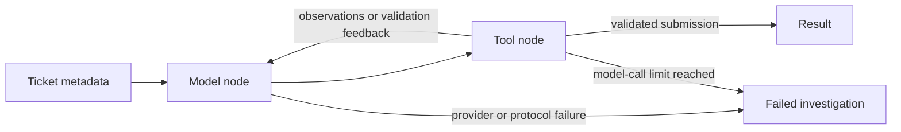

# Agent execution

## Workflow and provider boundary



The model receives the service, alert title, and evidence cutoff. It has no fixture object, scenario file name, expected answer, filesystem tool, shell tool, or action tool. Each tool request passes through the same incident-service and timestamp boundaries as the rules baseline. These are application-level capability boundaries, not a general process sandbox.

Providers are Groq, local Ollama, and Anthropic, selected with `--provider`. LangGraph controls the model/tool loop. Remote adapters use a 30-second request timeout; local Ollama uses 120 seconds. Output is limited to 1,024 tokens per request, with no automatic retries. An incident defaults to at most six model attempts and eight evidence tool calls; limits can be lowered or raised within explicit bounds. Groq/Ollama messages are translated to and from the graph's shared tool-call/result representation.

The tool node executes valid calls up to the evidence budget and returns errors for further requests. A separate submission does not consume an evidence call. Model and tool limits bound work; they are not an exact dollar cap. A tool budget does not stop the model from spending its remaining turns on a corrected submission.

Version 0.2 adds cause-specific backend evidence contracts, abstention-only routing once a fixed snapshot requires escalation, and up to two corrective responses by default. It records controller and policy versions and each turn's offered tools. See [reliability controls](reliability.md). The original v0.1 results below remain historical, rather than being silently relabeled as new-model performance.

No LangSmith endpoint, model name, API key, or cloud credentials are configured by the project. Optional tracing supplied by a user's environment is outside this local artifact's configuration.

## Submission validation

The model must finish through `submit_investigation`, in a separate turn from evidence requests. The backend checks:

- The exact result fields, value types, status, and supported cause vocabulary.
- Logs, metrics, and deployment history were attempted before submission.
- A hypothesis has successful responses from all three telemetry tools.
- Telemetry and runbook citations reference records actually returned by tools, in the correct categories.
- A hypothesis includes recent telemetry; an abstention has a null cause.

Invalid submissions produce feedback that the model can correct within its call budget. Missing required telemetry permits an abstention, not an unsupported hypothesis. An exhausted loop, malformed tool protocol, or provider error produces a `failed` result. It is never silently converted to a correct abstention.

These checks establish provenance and completion conditions. They do not prove that a cited record supports the model's explanation. Semantic correctness still needs evaluation and human inspection. Prompt instructions alone do not establish injection resistance.

The additional evidence contract checks recognized error events, temporally preceding changes where required, corroborated connection saturation, and competing supported causes across all fetched telemetry. Its format-specific checks are deliberately narrower than general semantic support. Runbook prose cannot create primary diagnostic signals.

## Offline demonstration

`agent-demo` executes fixed, hand-authored messages for `INC-007`. The messages request evidence and submit a pool-exhaustion hypothesis. The graph fetches and validates those records. Its output is labeled `scripted-demo-no-inference` and has zero LLM calls. The scripted answer must not be reported as an agent benchmark result.

## Live execution and comparison

For Groq, configure `GROQ_API_KEY` locally and select an account-accessible model with `GROQ_MODEL` or `--model`. The account must remain on its Free plan for no-cost hosted use. For downloaded local models, use Ollama and `OLLAMA_MODEL` or `--model`; no provider key is needed. Anthropic is an explicitly selected alternative using `ANTHROPIC_API_KEY` and `ANTHROPIC_MODEL`. No credentials are included in artifacts. The CLI does not read `.env` files.

```bash
uv run --locked --extra agent incident-lab agent --provider groq --scenario INC-007 --max-model-calls 6
uv run --locked --extra agent incident-lab compare --provider groq --max-model-calls 6
```

The comparison runs the same eight development cases through the rules and live agent. Scripted providers are refused. Its JSON output preserves individual outcomes, prompts' version identifier, visible conversations, tool and model events, supplied budgets, observed token usage, and stop reasons. The provider error message excludes credentials and raw response bodies.

API, rate-limit, and budget failures count as incorrect even when abstention was expected. The comparison command returns a nonzero exit code when an execution fails. A successfully completed comparison is not a quality acceptance gate. The adapter cannot inspect billing tier and never changes plans or falls back to a paid provider. See [free prototype setup](free-prototype.md).

Without both supplied input/output token rates, cost is unknown. Estimates use observed uncached tokens and supplied USD-per-million rates; unknown usage or cache usage prevents an estimate. Reports are not invoices, and no model pricing is hard-coded. Timings include local graph work and API time; compare enough repeated runs before drawing latency conclusions.

## Validation status

The offline graph, submission validation, call limits, failure accounting, SDK serialization, and Groq/Ollama message conversion are exercised by tests. Real local Qwen3-8B inference was evaluated once per development case: five expected behavior matches out of eight, including four correct diagnoses and one correct abstention. Two unsupported diagnoses and one protocol failure remain. See [the preserved comparison](qwen3-8b-comparison.md). Groq and Anthropic have only mock-transport validation. The guarded v0.2 workflow is reported in [the reliability experiment](reliability-results.md), including the local HTTP adapter and approved sandbox recovery. Bedrock and external production adapters remain future work.

API and graph references used during implementation: [LangGraph Graph API](https://docs.langchain.com/oss/python/langgraph/graph-api), [Anthropic tool definitions](https://platform.claude.com/docs/en/agents-and-tools/tool-use/define-tools), and [Messages API](https://platform.claude.com/docs/en/api/python/messages/create).
